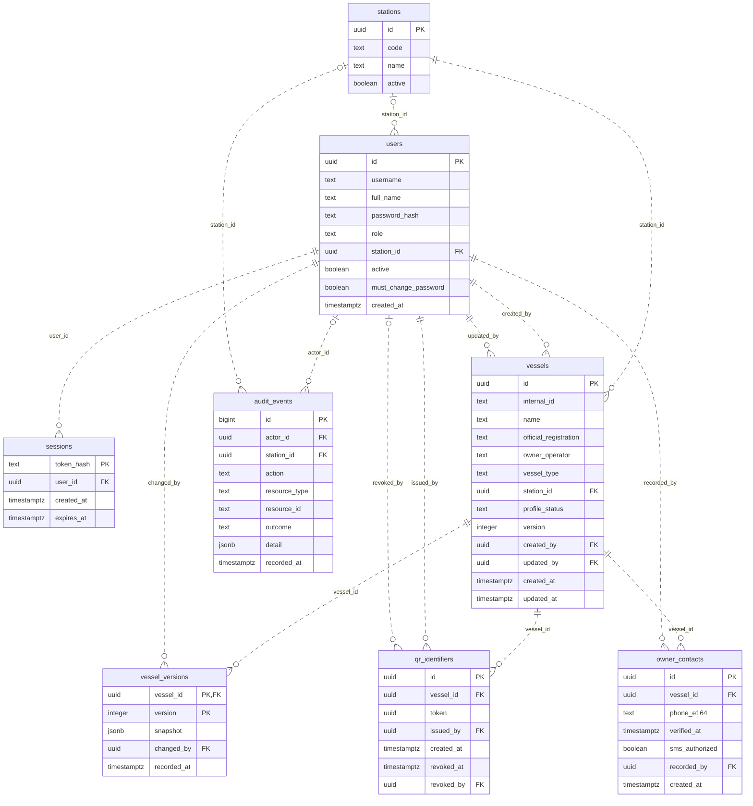
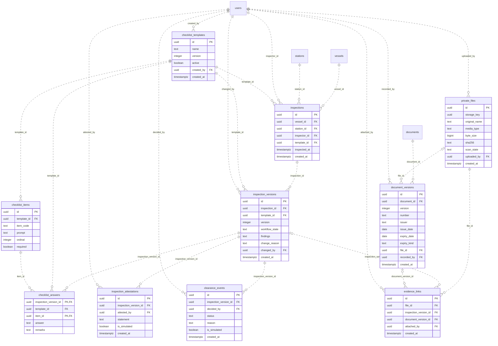
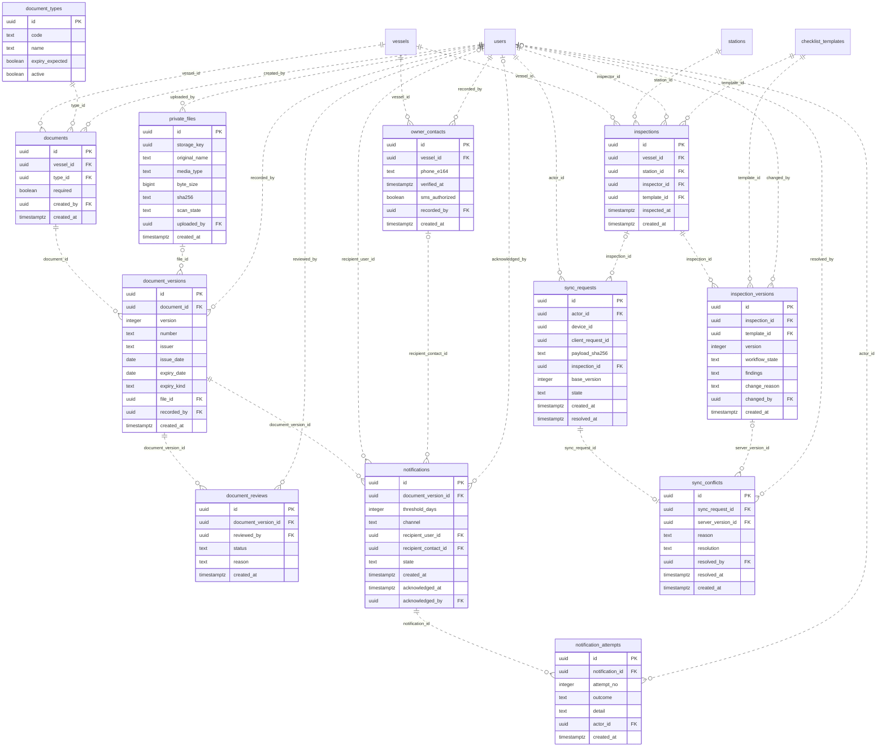
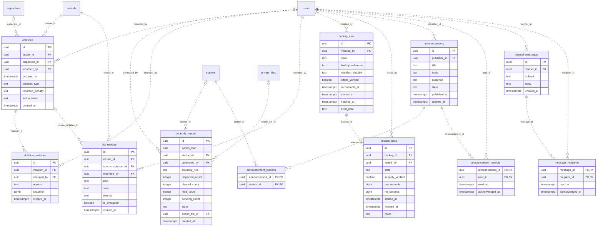

# Database ERD V2.0

36 tables, split into readable views. Dashed relationships are non-identifying; each FK parent has zero or more children; a nullable FK permits zero parents. Composite FKs constrain the same template/vessel and are documented in the dictionary. Repeated parent entities are intentional. Mermaid renders in GitHub.

## Registry, access, audit

## Inspections and evidence

## Documents, notifications, sync

## Reporting, violations, recovery and communication

## Business invariants not enforced by cardinality

Approval-dependent records are simulation-only. Current version selection, permitted cross-station history, state transitions, actor authority, report counting, scoped audiences, sync retries, and transactional audit coverage require application logic and integration tests. Future tables are inaccessible to the existing runtime role until those checks are delivered.

## Composite relationship integrity

- inspection_versions (inspection_id, template_id) → inspections (id, template_id).
- checklist_answers (inspection_version_id, template_id) → inspection_versions (id, template_id); (item_id, template_id) → checklist_items (id, template_id).
- violations (inspection_id, vessel_id) → inspections (id, vessel_id); inspection_id optional.
- list_reviews (source_violation_id, vessel_id) → violations (id, vessel_id); source_violation_id optional.
- Active QR is unique per vessel; historical revoked QR rows remain one-to-many. Evidence/alert recipient deduplication is enforced with partial unique indexes.
